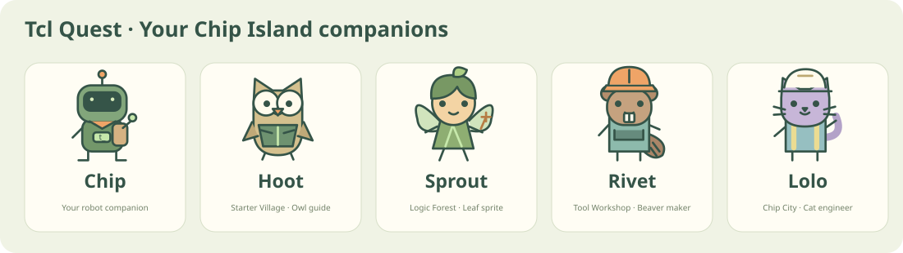

# Tcl Quest · Chip Island Adventure

[中文](README.md) · **English**

A beginner-friendly Tcl learning game for a VLSI course project. All ages are welcome.

**20 missions · 4 Boss challenges · 5 companions · 80 illustrated story beats · real Tcl in your browser**



Start with a greeting, explore variables and loops, build reusable tools and finish with a teaching timing-report analyzer. There are no timers, lives or locked lessons. Wrong answers cost no points.

## Open the game

The repository is private during development. No public website has been deployed.

```sh
git clone https://github.com/Su3037/tcl-quest.git
cd tcl-quest
python3 scripts/serve.py
```

Visit `http://127.0.0.1:8765/` in your browser. Choose **English** in the header. The button becomes **中文** when English is selected. Your language preference is saved, while drafts, XP, badges and the current execution replay are shared between languages.

Use an HTTP server rather than double-clicking the HTML file. No Tcl or Node installation is required to play. The browser runtime and all assets are stored in this repository; no external CDN is required.

You can also use the included GitHub Codespaces Dev Container:

```sh
python3 scripts/serve.py --host 0.0.0.0
```

Open port 8765 from the Ports panel and keep it **Private**. GitHub plan limits or charges may apply.

## Make your code move the story

The right-hand computer contains your code editor above **Chip’s Live Story Window**. Choose **Run code** to execute the program in a real Tcl 8.6.6 WebAssembly interpreter. Actual assignments, loop updates, procedure returns, file operations, object operations and printed output advance the illustration.

For example, changing a collection list to `{3 5 9}` produces real intermediate totals **3 → 8 → 17**. Comments and branches that never execute do not activate those actions. If execution fails, the replay retains the operations completed before the error.

Pause, step through, replay or jump to the end. The four-beat teaching guide is also available above the workspace. It explains authored examples; the live story below the editor follows your actual run. Both are separate from grading: only **Check mission** can award XP after the required output and behavior checks pass.

Read [the execution-story design](docs/RUNTIME.md) for the supported observations and limits. This teaching visualization is not a full source-line debugger.

## Your route

| World | Lessons | Skills | Boss project |
| --- | --- | --- | --- |
| Starter Village | [01](lessons/01/README.en.md)–[05](lessons/05/README.en.md) | Output, comments, variables, quoting, arithmetic | Launch beacon |
| Logic Forest | [06](lessons/06/README.en.md)–[10](lessons/10/README.en.md) | Conditions, lists, loops, strings | Supply selector |
| Tool Workshop | [11](lessons/11/README.en.md)–[15](lessons/15/README.en.md) | Procedures, dictionaries, files, errors | General average tool |
| Chip City | [16](lessons/16/README.en.md)–[20](lessons/20/README.en.md) | Namespaces, regular expressions, TclOO, modules, slack | Teaching report analyzer |

Each lesson includes a story, illustration, explanation, runnable example, task, starter code, hints, concept question, common pitfall, extension and reference solution. The website and Markdown lessons are generated from authored course sources.

Ordinary lessons award 100 XP and Bosses 200 XP: **2400 XP and four badges** in total. XP is awarded only once per lesson. Progress is saved in this browser; export and import it from Getting Started to move between devices.

## English demonstration videos

Four original silent videos include English on-screen explanations, captions and transcripts.

| Demo | Video | Transcript |
| --- | --- | --- |
| First code and variables | [MP4](site/media/demo-1-en.mp4) | [Text](site/media/demo-1-en.txt) |
| Lists, conditions and loops | [MP4](site/media/demo-2-en.mp4) | [Text](site/media/demo-2-en.txt) |
| Procedures and safe calculations | [MP4](site/media/demo-3-en.mp4) | [Text](site/media/demo-3-en.txt) |
| A teaching timing report | [MP4](site/media/demo-4-en.mp4) | [Text](site/media/demo-4-en.txt) |

## Native Tcl and development

Use Tcl **8.6+**, which includes TclOO. The old Tcl 8.5 shipped with some macOS versions cannot run lesson 18. Install a current Tcl through your usual package manager, then run:

```sh
tclsh lessons/01/starter.tcl
python3 scripts/check.py 1 lessons/01/starter.tcl
```

The English interface translates explanations and starter comments, while executable solutions, required output and behavior assertions remain consistent between languages. Existing user drafts and native output are never automatically translated.

Development requires Python 3, Node.js 18+ and Tcl 8.6+. See the Chinese README and GitHub Actions workflow for the generation and verification commands. English videos can be rebuilt with `scripts/render_videos.py --lang en` using the documented Pillow, ffmpeg and font dependencies.

## Scope and license

This course teaches Tcl through simplified chip-design data. `lab::area` and `mockFlow` are teaching models, not commercial EDA engines. The final project does not replace a vendor timing-report parser or generate GDS.

The course scope references the teacher’s [Tcl Language Course](https://sjtu-yongfu-research-grp.github.io/tcl-language/). Original stories, illustrations and videos were created for this repository. Original material is licensed under [MIT](LICENSE); the bundled Tcl/Wacl/RequireJS runtime retains its own licenses in [vendor](site/vendor/README.md).
