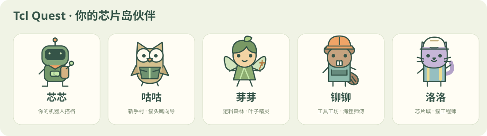

<div align="center">

# Tcl Quest · 芯片岛冒险

[English](README.en.md) · **中文**

**写下第一行代码，开启你的芯片岛冒险。**

面向零基础大众的中文 Tcl 教学仓库 · VLSI 课程项目

20 个互动场景 · 80 幕剧情 · 5 位统一风格角色 · 4 个 Boss · 4 段视频 · 浏览器真 Tcl 实验室

[从第 1 关开始](lessons/01/README.md) · [教学使用指南](docs/TEACHING.md) · [发布网站](docs/PUBLISHING.md) · [设计与技术说明](docs/ARCHITECTURE.md) · [角色与场景说明](docs/ADVENTURE.md)

</div>



不要求你提前懂编程。每关先讲一个故事，用生活中的事解释代码，再给你一个能动手完成的小任务。答错不扣分，所有关卡自由探索，每次尝试都是进步。

## 现在就打开互动页面

**[打开网页版游戏 →](https://su3037.github.io/tcl-quest/)**

无需登录、安装软件或启动本地服务器。网站由 GitHub Pages 托管；代码在访问者自己的浏览器中执行，不使用作者的 Mac。中文与 English 可在游戏顶栏切换。

如需本地开发或离线保存项目：

```sh
git clone https://github.com/Su3037/tcl-quest.git
cd tcl-quest
python3 scripts/serve.py
```

访问终端显示的 `http://127.0.0.1:8765/`。**不要直接双击 `site/index.html`**：浏览器的模块、Worker 和资源加载需要 HTTP 服务。网页运行不需要安装 Tcl 或 Node.js，不使用外部 CDN。

也可以在仓库的 **Code → Codespaces → Create codespace on main** 打开云端环境，然后运行：

```sh
python3 scripts/serve.py --host 0.0.0.0
```

在 Ports 面板打开 8765，**保持端口 Private**。Codespaces 是否可用及费用以 GitHub 账户额度为准。这个在线开发环境与无需账户的静态网页实验室是两种使用方式。

## 你的冒险地图

| 地图 | 关卡 | 学会什么 | Boss 作品 |
| --- | --- | --- | --- |
| 🌱 新手村 | [01](lessons/01)–[05](lessons/05) | 输出、注释、变量、引用与替换、算术 | 修好出发信标 |
| 🌲 逻辑森林 | [06](lessons/06)–[10](lessons/10) | 条件、列表、循环、字符串 | 给精灵分配补给 |
| 🔧 工具工坊 | [11](lessons/11)–[15](lessons/15) | 过程、字典与数组、文件、错误处理 | 通用平均值工具 |
| 🏙️ 芯片城 | [16](lessons/16)–[20](lessons/20) | 命名空间、正则、TclOO、模块化、时序余量 | 时序报告分析器 |

右侧编辑器下方新增**实时剧情窗**：运行你的代码后，真实 Tcl 的变量更新、循环、返回值和输出会驱动动画。比如改用 `{3 5 9}` 求和，芯芯会按实际总数 **3 → 8 → 17** 推进。支持暂停、单步回放、重播与快进；注释和未执行分支不会触发操作。详情见[执行驱动剧情](docs/RUNTIME.md)。

游戏顶栏可切换 **English / 中文**，涵盖课程、NPC、场景、指南和视频；草稿与进度共享，当前回放位置保留，用户代码与原生输出不翻译。

每关还由机器人芯芯和区域 NPC 带你看一段四幕图解：能播放、暂停、逐步查看，也能切换输入观察变化。20 个场景各有与知识点对应的插图和动作，例如变量背包、金币门、循环采集、文件日记和时序路径。60 组演示输入全部经过真实 Tcl 验证，可一键送入实验室运行。

每关还包括概念说明、可运行示例、待完成代码、目标输出、两级提示、理解题、易错提醒、拓展任务和参考解法。网页与仓库讲义来自同一份课程源文件。剧情图解解释指定示例，实验室的实时回声显示你自己代码的真实输出，详见[角色与场景说明](docs/ADVENTURE.md)。

- 普通关首次通过：100 XP；Boss 首次通过：200 XP。共 2400 XP，4 枚徽章。
- 不设体力、连续签到或强制锁关。普通关约 10 分钟，Boss 约 20 分钟。
- 提交检查输出及关键行为；过程题还会测试新输入、空输入、边界或小数。
- 草稿、进度保存在当前浏览器，可导出和导入 JSON。清理浏览器数据会清除本地进度。
- 页面支持键盘操作、文字图解、可见焦点、中文字幕和视频文字稿；音效默认关闭；打开时会试听，运行、检查和首次通关有提示音，开关偏好保存在当前浏览器。采集、开门、获得物品、制作与读写等动作音效跟随场景回放的实际步骤；按钮和答题也有反馈音。答对题目或通过关卡会显示不挡操作的全屏庆祝，减少动态效果模式下改用静态提示。

## 演示放映室

四段原创、无配音代码演示，每段 60 秒，带画面中文解释、可切换字幕及完整文字稿。网页的“演示放映室”可直接播放；也可下载：

| 演示 | 视频 | 文字稿 |
| --- | --- | --- |
| 第一行代码与变量 | [MP4](site/media/demo-1.mp4) | [文字稿](site/media/demo-1.txt) |
| 列表、条件与循环 | [MP4](site/media/demo-2.mp4) | [文字稿](site/media/demo-2.txt) |
| 过程与安全计算 | [MP4](site/media/demo-3.mp4) | [文字稿](site/media/demo-3.txt) |
| 一份报告，一次芯片冒险 | [MP4](site/media/demo-4.mp4) | [文字稿](site/media/demo-4.txt) |

## 在真正的 tclsh 中练习

推荐 Tcl **8.6+**（包含 TclOO）。macOS 自带的旧 Tcl 8.5 无法运行第 18 关。可使用 `brew install tcl-tk` 安装新版；Ubuntu 可执行 `sudo apt-get install tcl`；Windows 从 [Tcl 官方软件下载页](https://www.tcl-lang.org/software/tcltk/) 选择适合的发行版并将 `tclsh` 加入 PATH。确认版本：

```sh
tclsh
# 在 Tcl 提示符输入：
puts [info patchlevel]
exit
```

修改 `lessons/01/starter.tcl`，然后：

```sh
tclsh lessons/01/starter.tcl
python3 scripts/check.py 1 lessons/01/starter.tcl
```

可参考 `example.tcl`，或遇到困难后再读 `solution.tcl`。文件练习会写入当前目录；建议在独立练习目录运行。自动检查器会使用临时目录。

## 开发与检查

仅 Python 3 标准库、Node.js 18+、Tcl 8.6+ 即可做日常开发与检查，无 npm 依赖。

```sh
python3 scripts/build_curriculum.py  # 修改课程源后重新生成讲义和 JSON
python3 scripts/build_adventures.py # 课程生成后更新剧情及演示输入
python3 scripts/build_messages.py  # UI 翻译目录
python3 scripts/build_english.py   # 英文课程与讲义
python3 scripts/build_english_adventures.py # 英文剧情
python3 scripts/build_trace.py     # 打包 Tcl 执行观察器
node scripts/export_artwork.mjs    # 导出中英文插图和角色图鉴
python3 scripts/build_assets.py    # 同步本地资源版本，防止旧缓存混用
python3 scripts/check.py --all      # 真 tclsh 执行所有示例和答案
node tests/wasm.mjs                 # 验证网页实际使用的 WASM 引擎与行为检查
python3 tests/adventures.py         # 原生 Tcl 执行全部 60 组剧情输入
python3 tests/localization.py      # 语言版本及英文媒体
python3 tests/artwork.py            # 检查 240 个场景帧的 SVG
python3 tests/site_integrity.py     # 内容、资源及视频完整性
node --check site/app.js
node --check site/runner.js
node --check site/adventure.js
node --check site/adventure-art.js
node --check site/live-runtime.js
node --check site/runtime-story.js
node --check site/i18n.js
```

重新生成视频需要 Pillow、ffmpeg 和中文字体，详见 [视频制作说明](docs/VIDEOS.md)。仓库已包含可直接播放的成品，无需重新生成。

## VLSI 范围

这里的重点是**学会 Tcl，再用 Tcl 处理芯片设计相关数据**。`lab::area` 和 `mockFlow` 是教学模拟；没有实现商业 EDA、Calibre、真实时序分析或 GDS 生成。第 20 关分析的是明确给定格式的教学记录，不能直接替代厂商报告解析器。

## 参考与授权

课程范围参考老师提供的 [Tcl Language Course](https://sjtu-yongfu-research-grp.github.io/tcl-language/)，重新设计了学习路线和任务；未复制其课文、图片或视频。语言语义以 [Tcl 8.6 官方手册](https://www.tcl-lang.org/man/tcl8.6/TclCmd/contents.htm) 为准。

本项目原创代码、讲义、图解和演示以 [MIT License](LICENSE) 提供；第三方引擎 Wacl、Tcl、RequireJS 及随附包保留各自授权，见 [第三方说明](site/vendor/README.md)。
