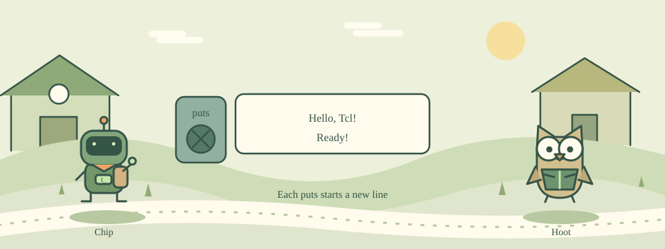

# 01 · Wake Up the Little Robot

[中文](README.md) · [Course home](../../README.en.md)

The robot on Chip Island is asleep. Wake it with your first greeting.



puts tells Tcl to display some text. Think of it as a small loudspeaker: puts "Hello" says Hello. Double quotes keep the words of one message together.

A line beginning with # is a comment. It explains the code to people; Tcl does not run it. Start with one command per line.

## Try this example

```tcl
puts "Hello, Tcl!"
# A comment: Tcl does not execute this line.
puts "Ready!"
```

## Your mission

Print Hello, Tcl! and then Ready!, with each message on its own line.

Expected output:

```text
Hello, Tcl!
Ready!
```

## Hints

Use two puts commands.

Wrap each message in double quotes.

## Watch out

Use straight quotes ", not curly quotation marks. Tcl command names are case-sensitive.

## Think about it

What do the double quotes in puts "Hello world" do?

1. Group the sentence as one argument
2. Turn the text into a comment
3. Run the command twice

<details><summary>Answer</summary>

Group the sentence as one argument

</details>

## One more step

Replace the greeting with your own name and run it again.
