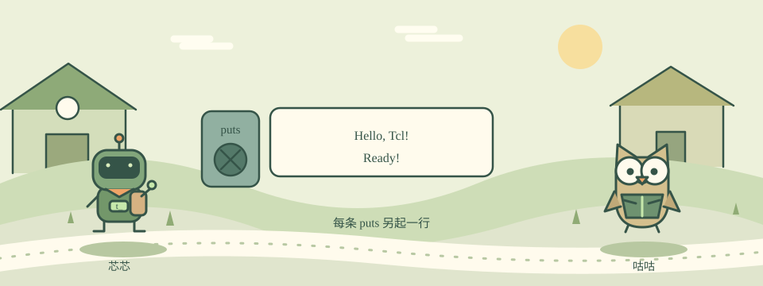

# 01 · 唤醒小机器人

芯片岛的机器人睡着了。用第一条指令向它打招呼。

目标：puts · 注释。约 10 分钟，首次通关 +100 XP。



网页中可播放四幕剧情、切换输入，与 NPC 一起观察代码。打开方式见[仓库首页](../../README.md#现在就打开互动页面)。

Tcl 读作 tickle。它是一种让电脑按步骤做事的语言。把 puts 想成机器人的小喇叭：后面跟什么，它就说什么。

一行通常是一条命令。命令名和参数之间用空格分开；双引号把一句话包成一个参数。以 # 开头的完整行是注释，写给人看。

## 图解

```text
命令 puts
   ↓
参数 "Hello, Tcl!"
   ↓
输出 Hello, Tcl!
```

## 先看示例

```tcl
puts "Hello, Tcl!"
# 这行不会被说出来
puts "Ready!"
```

## 你的任务

让机器人依次输出 Hello, Tcl! 和 Ready!，每句话单独一行。

预期输出：

```text
Hello, Tcl!
Ready!
```

运行 `tclsh lessons/01/starter.tcl`。检查：`python3 scripts/check.py 1 lessons/01/starter.tcl`。

<details><summary>给我一点提示</summary>

说话的命令是 puts。

第二条指令是 puts "Ready!"。

</details>

## 常见坑

Tcl 区分大小写：Puts 和 puts 不是同一条命令。

## 理解检查

puts "Hello world" 中，双引号有什么用？

1. 把一句话当成一个参数
2. 让文字变成注释
3. 重复运行两次

<details><summary>查看解释</summary>

正确选项：把一句话当成一个参数。回到上面的概念，再用示例验证一次。

</details>

## 再试一步

把打招呼的内容换成你喜欢的角色名，再点运行。
