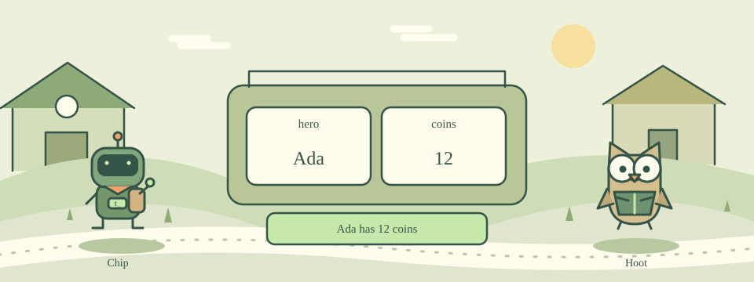

# 02 · Label Your Backpack

[中文](README.md) · [Course home](../../README.en.md)

Before you set off, put your coins in a backpack pocket with a name.



A variable is a named pocket that holds a value. set coins 8 puts 8 in the pocket called coins. You can replace it with another value later.

Use $coins to read the value. In double quotes, Tcl replaces $hero and $coins with their stored values. set assigns a value; $ reads it.

## Try this example

```tcl
set coins 8
puts $coins
set coins 12
puts "Coins: $coins"
```

## Your mission

Create hero with the value Ada and coins with the value 12. Print Ada has 12 coins.

Expected output:

```text
Ada has 12 coins
```

## Hints

Use set hero Ada and set coins 12.

Use puts "$hero has $coins coins" to build the sentence.

## Watch out

Do not put $ before the variable name when assigning it: use set coins 12.

## Think about it

Which command stores 12 in coins?

1. set coins 12
2. set $coins 12
3. coins = 12

<details><summary>Answer</summary>

set coins 12

</details>

## One more step

Change the coin count, then print the same sentence again.
