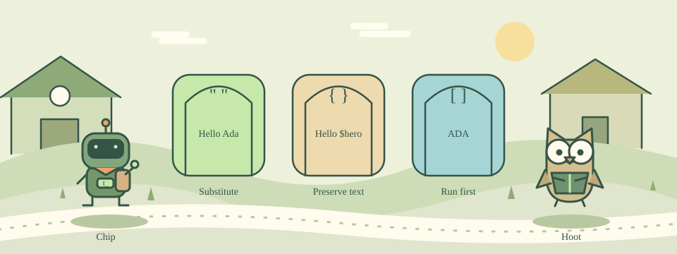

# 03 · The Three Bracket Doors

[中文](README.md) · [Course home](../../README.en.md)

Three doors treat the same message differently: substitute, preserve, or run a command first.



Double quotes group words and allow variable and command substitution. Braces group words while normally preserving their contents at this stage: {Hello $hero} keeps the dollar sign and name.

Square brackets run the command inside first and substitute its result. Tcl then passes that result to the surrounding command. Braces are also commonly used for scripts and expressions.

## Try this example

```tcl
set n 3
puts "value=$n"
puts {value=$n}
puts [string toupper hi]
```

## Your mission

Set hero to Ada. Print Hello Ada, then the literal text Hello $hero, then ADA on separate lines.

Expected output:

```text
Hello Ada
Hello $hero
ADA
```

## Hints

Use double quotes for the first line and braces for the second.

For the third line, use [string toupper $hero].

## Watch out

Brackets run a Tcl command, not arbitrary text. Every opening bracket or brace needs its matching closing partner.

## Think about it

What does puts {$hero} print?

1. The literal text $hero
2. The value of hero
3. Nothing

<details><summary>Answer</summary>

The literal text $hero

</details>

## One more step

Change hero to Bo and predict all three lines before running them.
