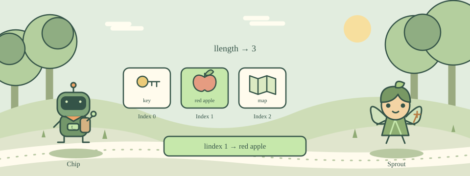

# 07 · Pack an Item List

[中文](README.md) · [Course home](../../README.en.md)

Pack a key, an apple and a map without losing each item’s boundary.



A list keeps track of its elements. list key "red apple" creates two elements, even though red apple contains a space. lappend adds another element to a list variable.

llength counts elements. lindex selects one by its index, starting at 0. The second item therefore has index 1.

## Try this example

```tcl
set bag [list key "red apple"]
lappend bag map
puts [llength $bag]
puts [lindex $bag 1]
```

## Your mission

Create bag containing key, red apple and map in that order. Print the count 3 and then the second item, red apple.

Expected output:

```text
3
red apple
```

## Hints

Create the list with [list key "red apple" map].

Use llength for the count and lindex with index 1 for the second item.

## Watch out

Do not treat every space as an element boundary. Use list and proper grouping when an item contains spaces.

## Think about it

What is the first index in a list?

1. 0
2. 1
3. -1

<details><summary>Answer</summary>

0

</details>

## One more step

Append a compass and verify that the list now contains four items.
