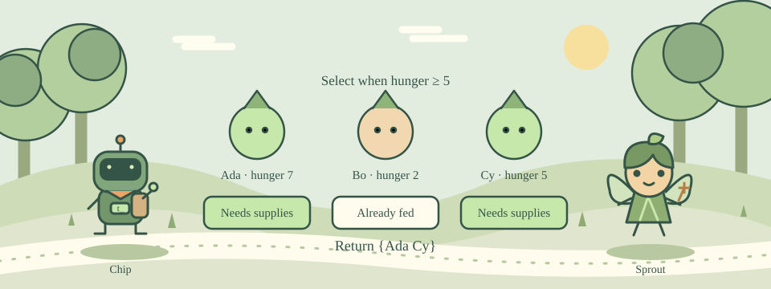

# 10 · BOSS · Deliver Supplies

[中文](README.md) · [Course home](../../README.en.md)

Three forest friends have different hunger levels. Find out who needs supplies.



Each record is a list containing a name and hunger value. foreach visits the records, and lassign extracts their fields into variables.

Use if to select records and lappend to collect their names. The returned value should remain a list so that names containing spaces keep their boundaries.

## Try this example

```tcl
foreach row {{Ada 4} {Bo 8}} {
    lassign $row name hunger
    puts "$name: $hunger"
}
```

## Your mission

Implement supply {rows}. Each row is {name hunger}. Return a list of names with hunger >=5. For the sample, print Ada Cy.

Expected output:

```text
Ada Cy
```

## Hints

Check if {$hunger >= 5}.

Inside that branch, use lappend selected $name.

## Watch out

Do not join the list before returning it; that can lose the boundaries of names containing spaces.

## Think about it

Why do the checks use different character names?

1. To verify that the rule works for new input
2. To make the code longer
3. Tcl only accepts three names

<details><summary>Answer</summary>

To verify that the rule works for new input

</details>

## One more step

Raise the threshold to 8 and see which friends no longer need supplies.
