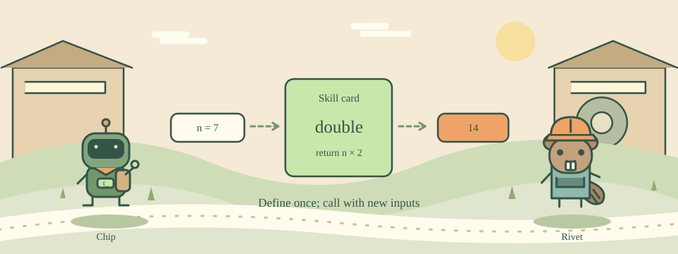

# 11 · Make a Reusable Skill Card

[中文](README.md) · [Course home](../../README.en.md)

Put a greeting into a skill card that works for more than one name.



proc defines a reusable procedure, like a recipe with input slots. proc greet {name} {...} defines greet with an argument named name. Calling greet Ada supplies Ada for that argument.

Ordinary variables inside a procedure are usually local. return hands a result back to the caller; puts displays text. Arguments may also have default values.

## Try this example

```tcl
proc greet {name {place Island}} {
    return "Hello $name at $place"
}
puts [greet Ada]
puts [greet Bo Forest]
```

## Your mission

Implement double {n} to return twice its input. Print 14 for double 7.

Expected output:

```text
14
```

## Hints

Calculate with expr.

Use return [expr {$n * 2}] to pass the result back.

## Watch out

Printing inside a procedure does not usually provide the result that an outer expr needs.

## Think about it

Which command gives a computed result back to the caller?

1. return
2. puts
3. #

<details><summary>Answer</summary>

return

</details>

## One more step

Add times {n factor} so the multiplier becomes an argument too.
