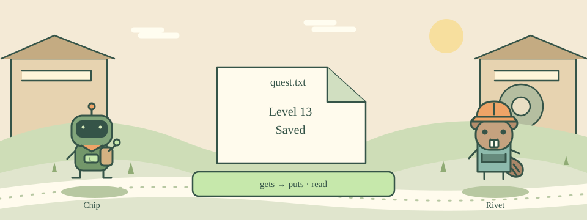

# 13 · Save Your Adventure Log

[中文](README.md) · [Course home](../../README.en.md)

Write your story to a file and read it back.



open returns a file channel, like a pipe connected to the file. Mode w creates or overwrites a file; r reads and a appends. puts $f writes text to that channel.

gets $f reads one line and close $f closes the channel. The browser uses an in-memory virtual filesystem; this does not automatically save a file on your computer. Each run starts a fresh environment.

## Try this example

```tcl
set f [open diary.txt w]
puts $f "Day 1: Ready"
close $f
set f [open diary.txt r]
puts [gets $f]
close $f
```

## Your mission

Write Level 13 and Saved as two lines in quest.txt. Close it, reopen for reading, and print both lines.

Expected output:

```text
Level 13
Saved
```

## Hints

Write with puts $f "Level 13".

After closing the write channel, reopen using set f [open quest.txt r].

## Watch out

On a real computer, w overwrites an existing file. Practice with dedicated exercise filenames.

## Think about it

What does mode w do to an existing file?

1. Overwrites its contents
2. Only reads it
3. Automatically backs up every version

<details><summary>Answer</summary>

Overwrites its contents

</details>

## One more step

Use a to append a third line in local Tcl, then read the file again.
