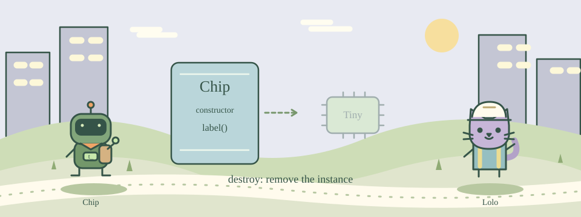

# 18 · Build a Chip Object

[中文](README.md) · [Course home](../../README.en.md)

Draw a blueprint, then manufacture objects from it.



A class is a blueprint; an object is a particular instance made from it. TclOO is included in Tcl 8.6+. A constructor initializes an object’s state, and methods operate on that object.

An object variable belongs to its instance. Two Chip objects can therefore keep different names. Call a method with $object method and destroy the object when you are finished.

## Try this example

```tcl
oo::class create Lamp {
    variable state
    constructor {} {set state off}
    method on {} {set state on}
    method status {} {return $state}
}
set lamp [Lamp new]
$lamp on
puts [$lamp status]
$lamp destroy
```

## Your mission

Create class Chip. Its constructor {value} stores name, and method label {} returns name. Create an object called Tiny and print Tiny.

Expected output:

```text
Tiny
```

## Hints

label must return the object variable name.

Use return $name in the method.

## Watch out

Call an object method using $object method, not object.method().

## Think about it

Which comparison best describes classes and objects?

1. A blueprint and models made from it
2. A filename and its extension
3. Addition and multiplication

<details><summary>Answer</summary>

A blueprint and models made from it

</details>

## One more step

Add a rename {value} method that updates the object’s name.
