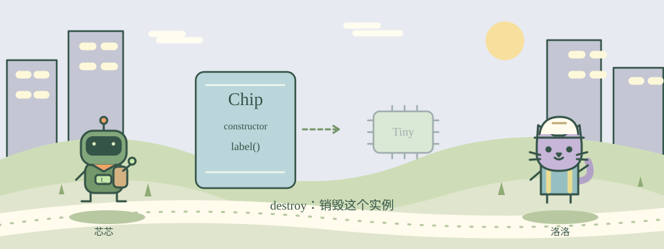

# 18 · 打造会行动的芯片对象

[English](README.en.md) · [课程首页](../../README.md)

设计一张芯片图纸，再从图纸造出多个对象。

目标：TclOO · class · method。约 10 分钟，首次通关 +100 XP。



网页中可播放四幕剧情、切换输入，与 NPC 一起观察代码。打开方式见[仓库首页](../../README.md#现在就打开互动页面)。

类像图纸，对象像按图纸造出来的模型。Tcl 8.6 自带 TclOO。oo::class create 定义类，constructor 初始化状态，method 定义对象的动作。

类中 variable 声明对象自己的变量。不同对象各有一份状态，修改一个对象不该影响另一个。最后可以 destroy 对象释放它。

## 图解

```text
类 Chip
   ↓
对象 Tiny
   ↓
对象 Nova
```

## 先看示例

```tcl
oo::class create Lamp {
    variable state
    constructor {} {set state off}
    method on {} {set state on}
    method status {} {return $state}
}
set lamp [Lamp new]
$lamp on
puts [$lamp status]
$lamp destroy
```

## 你的任务

创建类 Chip：constructor {value} 保存 name；method label {} 返回 name。创建名为 Tiny 的对象并输出 Tiny。

预期输出：

```text
Tiny
```

运行 `tclsh lessons/18/starter.tcl`。检查：`python3 scripts/check.py 18 lessons/18/starter.tcl`。

<details><summary>给我一点提示</summary>

label 应当返回对象变量 name。

使用 return $name。

</details>

## 常见坑

对象方法的调用形式是 $object method，而不是 object.method()。

## 理解检查

类和对象的关系更像？

1. 图纸和按图纸制造的模型
2. 文件名和文件后缀
3. 加法和乘法

<details><summary>查看解释</summary>

正确选项：图纸和按图纸制造的模型。回到上面的概念，再用示例验证一次。

</details>

## 再试一步

增加一个 rename {value} 方法，更新对象的名字。
